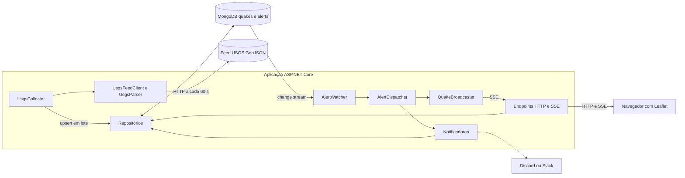
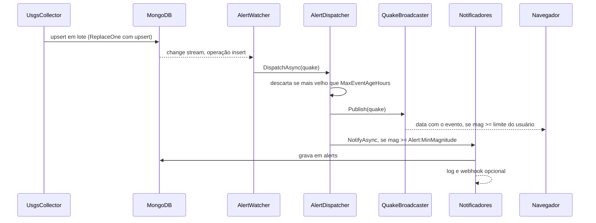
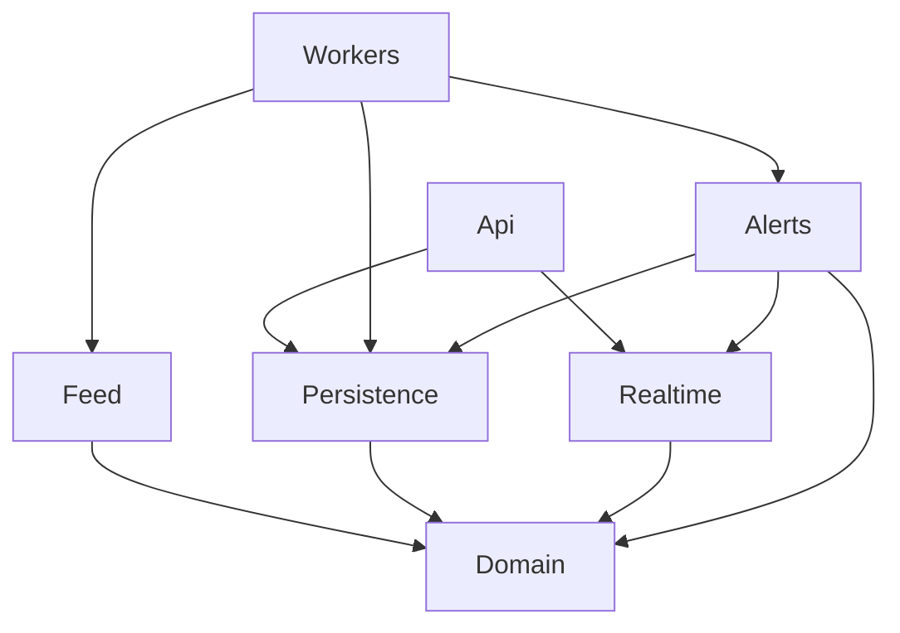

# Quake Radar


Mapa de terremotos quase em tempo real. Um serviço em C# consulta o feed público do USGS a cada minuto, guarda os eventos no MongoDB e os exibe numa página com mapa. É possível buscar terremotos num raio de X km de qualquer ponto, ver estatísticas e receber um alerta ao vivo no navegador (e opcionalmente no Discord ou Slack) quando entra um evento acima de uma magnitude escolhida.

Projeto de estudo de MongoDB com C#. Os dados são do [USGS Earthquake Hazards Program](https://earthquake.usgs.gov/earthquakes/feed/), públicos e sem chave de API.

## Funcionalidades

- Coleta automática do feed do USGS: um mês de histórico na partida e atualização a cada 60 segundos.
- Busca por proximidade: "terremotos num raio de 500 km de Tóquio nos últimos 7 dias".
- Mapa com círculos coloridos e dimensionados pela magnitude, popup com detalhes e link para o USGS.
- Estatísticas calculadas no banco: por dia, por faixa de magnitude e por região.
- Alerta em tempo real no navegador (Server-Sent Events) com magnitude mínima escolhida pelo usuário.
- Alertas persistidos e notificação opcional por webhook (Discord ou Slack) acima de um limite do servidor.
- Prova do ganho do índice geoespacial com `explain()`.
- Descarte automático de eventos com mais de 30 dias.

## Como rodar

Pré-requisito: Docker. Para desenvolvimento local também é preciso o .NET 8 SDK.

### Um comando

```bash
docker compose up --build
```

Abra http://localhost:5000. Na primeira execução o serviço baixa o último mês de terremotos (cerca de 10 mil eventos), então o mapa leva alguns segundos para encher.

Para definir o limite de alerta ou o webhook, copie `.env.example` para `.env` e edite:

```bash
cp .env.example .env
```

### Desenvolvimento local

```bash
docker compose up -d mongo
dotnet run --project src/QuakeRadar --urls http://localhost:5000
```

Rodar os testes:

```bash
dotnet test
```

## Configuração

As opções ficam em `src/QuakeRadar/appsettings.json` e podem ser sobrescritas por variáveis de ambiente, usando `__` no lugar de `:`.

| Opção | Variável de ambiente | Padrão | Descrição |
|---|---|---|---|
| `Mongo:ConnectionString` | `Mongo__ConnectionString` | `mongodb://localhost:27017/?directConnection=true` | Conexão com o MongoDB |
| `Mongo:Database` | `Mongo__Database` | `quakeradar` | Nome do banco |
| `Mongo:RetentionDays` | `Mongo__RetentionDays` | `30` | Dias até o TTL apagar um evento |
| `Collector:BaseUrl` | `Collector__BaseUrl` | URL dos feeds do USGS | Base dos feeds GeoJSON |
| `Collector:BackfillFeed` | `Collector__BackfillFeed` | `all_month` | Feed carregado na partida |
| `Collector:LiveFeed` | `Collector__LiveFeed` | `all_hour` | Feed consultado a cada ciclo |
| `Collector:IntervalSeconds` | `Collector__IntervalSeconds` | `60` | Intervalo entre consultas |
| `Alert:MinMagnitude` | `Alert__MinMagnitude` | `5.0` | Magnitude mínima para gravar alerta e acionar notificadores |
| `Alert:MaxEventAgeHours` | `Alert__MaxEventAgeHours` | `6` | Eventos mais velhos que isso são ignorados pelo alerta |
| `Alert:WebhookUrl` | `Alert__WebhookUrl` | vazio | URL de webhook do Discord ou Slack |

O alerta ao vivo no navegador tem limite próprio, escolhido na página. O limite do servidor (`Alert:MinMagnitude`) controla só o que é gravado e enviado ao webhook.

## Arquitetura

### Visão geral



### Fluxo de ingestão e alerta



Só inserções disparam o fluxo. Quando o USGS revisa um evento existente, o upsert vira uma substituição, que o change stream filtrado ignora. Assim o mesmo terremoto nunca gera dois alertas.

### Camadas e dependências



O domínio não depende de nada do projeto. As camadas de cima conversam com interfaces, e as implementações concretas são ligadas ao `ServiceCollectionExtensions`.

### Estrutura de pastas

```
QuakeRadar/
├── .github/workflows/ci.yml          # build, testes e build da imagem Docker
├── src/QuakeRadar/
│   ├── Domain/                       # Quake e Alert (documentos do MongoDB)
│   ├── Configuration/                # classes de opções (Mongo, Collector, Alert)
│   ├── Feed/                         # IFeedClient, UsgsFeedClient e UsgsParser
│   ├── Persistence/                  # repositórios, modelos de consulta e índices
│   ├── Realtime/                     # QuakeBroadcaster e assinaturas SSE
│   ├── Alerts/                       # AlertDispatcher e notificadores
│   ├── Workers/                      # UsgsCollector e AlertWatcher (BackgroundService)
│   ├── Api/                          # endpoints, contratos e registro das rotas
│   ├── Composition/                  # raiz de composição da injeção de dependência
│   ├── wwwroot/index.html            # página com mapa
│   ├── appsettings.json
│   └── Program.cs
├── tests/QuakeRadar.Tests/           # testes xUnit
├── Dockerfile
├── docker-compose.yml                # MongoDB em replica set e a aplicação
├── QuakeRadar.sln
└── README.md
```

### Componentes

| Componente | Responsabilidade |
|---|---|
| `UsgsCollector` | Serviço em segundo plano. Carrega o histórico na partida e consulta o feed em intervalo fixo. |
| `UsgsFeedClient` | Baixa o feed pelo `HttpClient` nomeado `usgs` e entrega documentos de domínio. |
| `UsgsParser` | Converte o GeoJSON do USGS em `Quake`. Função pura, sem rede e sem banco. |
| `MongoQuakeRepository` | Upsert em lote, busca por raio e change stream de inserções. |
| `MongoQuakeStatsRepository` | Agregações por dia, faixa e região, e o `explain()`. |
| `MongoAlertRepository` | Grava e lista alertas. |
| `QuakeIndexInitializer` | Cria os índices na partida, antes dos demais serviços. |
| `AlertWatcher` | Escuta o change stream e repassa cada evento novo ao dispatcher. Reabre o stream se ele cair. |
| `AlertDispatcher` | Filtra por idade, publica para os navegadores e aciona os notificadores acima do limite. |
| `QuakeBroadcaster` | Publicador em memória, com um canal por navegador conectado. |
| `IAlertNotifier` | Contrato de notificação, com três implementações: gravar, registrar no log e webhook. |

## MongoDB em detalhe

### Modelo de documento

Coleção `quakes`:

```json
{
  "_id": "us7000abcd",
  "Mag": 5.1,
  "Place": "45 km SE of Hitachi, Japan",
  "Time": "2026-11-01T03:12:45Z",
  "DepthKm": 38.2,
  "Url": "https://earthquake.usgs.gov/earthquakes/eventpage/us7000abcd",
  "Location": { "type": "Point", "coordinates": [140.9, 36.3] }
}
```

O `_id` é o identificador do próprio USGS. Como o `_id` já é único, não há índice único extra, e o upsert pelo `_id` garante que a coleta não duplica eventos, mesmo se rodar duas vezes. As coordenadas seguem a ordem do GeoJSON: longitude primeiro, depois latitude.

Coleção `alerts`:

```json
{
  "_id": { "$oid": "..." },
  "QuakeId": "us7000abcd",
  "Mag": 5.1,
  "Place": "45 km SE of Hitachi, Japan",
  "QuakeTime": "2026-11-01T03:12:45Z",
  "CreatedAt": "2026-11-01T03:13:02Z"
}
```

### Índices

| Coleção | Índice | Finalidade |
|---|---|---|
| `quakes` | `2dsphere` em `Location` | Busca por raio com `$nearSphere` e `$geoWithin` |
| `quakes` | Ascendente em `Time` com TTL de 30 dias | O MongoDB apaga eventos antigos sozinho, e o índice também serve para filtrar por período |

### Recursos do MongoDB usados

| Recurso | Onde | O que resolve |
|---|---|---|
| Índice `2dsphere` | `MongoQuakeRepository.FindNearAsync` | Resolve "terremotos num raio de X km" no banco, já ordenado do mais perto para o mais longe |
| Upsert em lote | `MongoQuakeRepository.UpsertManyAsync` | Coleta idempotente, que também aplica revisões de magnitude feitas pelo USGS |
| Aggregation pipeline | `MongoQuakeStatsRepository` | Estatísticas calculadas no servidor, sem trazer os dados para a aplicação |
| Change stream | `MongoQuakeRepository.WatchInsertsAsync` | Reage ao evento no instante em que ele entra, sem consultar o banco repetidamente |
| Índice TTL | `QuakeIndexInitializer` | Retenção de dados sem tarefa de limpeza |
| `explain()` | `MongoQuakeStatsRepository.ExplainNearAsync` | Mostra quantos documentos o banco examinou com e sem índice |

### Agregações

Terremotos por dia, com contagem, média e maior magnitude:

```json
[
  { "$match": { "Mag": { "$ne": null }, "Time": { "$gte": "<agora - N dias>" } } },
  { "$group": {
      "_id": { "$dateToString": { "format": "%Y-%m-%d", "date": "$Time" } },
      "total": { "$sum": 1 }, "avg": { "$avg": "$Mag" }, "max": { "$max": "$Mag" } } },
  { "$sort": { "_id": 1 } }
]
```

Faixas de magnitude com `$bucket`, em que eventos de qualquer valor fora das fronteiras caem em `outros`:

```json
{ "$bucket": {
    "groupBy": "$Mag",
    "boundaries": [-10, 2, 4, 5, 6, 10],
    "default": "other",
    "output": { "total": { "$sum": 1 }, "max": { "$max": "$Mag" } } } }
```

Ranking de regiões. O campo `Place` tem o formato `"45 km SE of Hitachi, Japan"`, então a região é o texto depois da última vírgula. Locais sem vírgula, como `"Mid-Atlantic Ridge"`, funcionam do mesmo jeito:

```json
[
  { "$addFields": { "Region": { "$trim": { "input":
      { "$arrayElemAt": [ { "$split": ["$Place", ","] }, -1 ] } } } } },
  { "$group": { "_id": "$Region", "total": { "$sum": 1 }, "max": { "$max": "$Mag" } } },
  { "$sort": { "total": -1 } },
  { "$limit": 15 }
]
```

### Change stream e replica set

Change streams só funcionam com o MongoDB em modo replica set. O `docker-compose.yml` sobe o Mongo como replica set de um único nó e um healthcheck inicia o conjunto na primeira execução. Por isso a conexão usa `directConnection=true`. Um MongoDB comum, sem replica set, não serve para este projeto.

## API

| Método e rota | Parâmetros | Descrição |
|---|---|---|
| `GET /quakes/near` | `lat`, `lon` (obrigatórios), `km` (500), `days` (7), `minMag` | Terremotos no raio, do mais perto para o mais longe, com limite de 500 |
| `GET /stats/per-day` | `days` (30) | Total, média e maior magnitude por dia |
| `GET /stats/by-magnitude` | `days` (30) | Contagem por faixa de magnitude |
| `GET /stats/by-region` | `days` (30) | As 15 regiões com mais eventos |
| `GET /stats/explain` | `lat`, `lon`, `km`, `semIndice` | Documentos examinados com e sem índice |
| `GET /alerts` | | Os 20 alertas gravados mais recentes |
| `GET /events/stream` | `minMag` (0) | Fluxo SSE de terremotos novos |
| `GET /health` | | Confere a conexão com o MongoDB |

Limites aplicados: `lat` entre -90 e 90, `lon` entre -180 e 180, `km` entre 1 e 20000, `days` entre 1 e 30. Coordenadas inválidas devolvem `400`.

### Exemplos

```bash
curl "http://localhost:5000/quakes/near?lat=35.68&lon=139.69&km=500&days=7&minMag=3"
```

```json
[
  {
    "id": "us7000abcd",
    "mag": 5.1,
    "place": "45 km SE of Hitachi, Japan",
    "time": "2026-11-01T03:12:45Z",
    "depthKm": 38.2,
    "url": "https://earthquake.usgs.gov/earthquakes/eventpage/us7000abcd",
    "lat": 36.3,
    "lon": 140.9
  }
]
```

```bash
curl "http://localhost:5000/stats/per-day?days=7"
curl "http://localhost:5000/stats/by-magnitude"
curl "http://localhost:5000/stats/by-region"
```

```bash
curl "http://localhost:5000/stats/explain?lat=35.68&lon=139.69&km=500"
curl "http://localhost:5000/stats/explain?lat=35.68&lon=139.69&km=500&semIndice=true"
```

```json
{ "plan": "IXSCAN",  "returned": 23, "documentsExamined": 190,   "keysExamined": 213,   "totalDocuments": 10412 }
{ "plan": "COLLSCAN", "returned": 23, "documentsExamined": 10412, "keysExamined": 0,     "totalDocuments": 10412 }
```

Os números acima são ilustrativos. O parâmetro `semIndice=true` força a leitura da coleção inteira com `hint({ $natural: 1 })`.

Fluxo ao vivo, mostrando só eventos de magnitude 2,5 ou mais:

```bash
curl -N "http://localhost:5000/events/stream?minMag=2.5"
```

## Front-end

Uma única página em `wwwroot/index.html`, sem build e sem framework, com [Leaflet](https://leafletjs.com) e mapa do OpenStreetMap.

- Painel esquerdo: região, raio, dias e magnitude mínima, os três números-resumo, a lista dos eventos mais fortes, as barras de terremotos por dia e os alertas.
- Mapa: um círculo tracejado marca o raio da busca, e cada evento é um círculo cujo tamanho e cor dependem da magnitude.
- Alerta ao vivo: o campo "Avisar a partir da magnitude" abre uma conexão `EventSource` com `/events/stream`. Quando chega um evento, a página mostra um aviso, adiciona o item à lista e atualiza o mapa. O navegador reconecta sozinho se a conexão cair.
- Atualização automática a cada 60 segundos.
- Tema claro e escuro conforme o sistema.

## Limitações

- O `QuakeBroadcaster` guarda as assinaturas em memória. Com várias instâncias da aplicação, cada uma só alcança os navegadores conectados nela. Para escalar, o publicador precisaria de um barramento compartilhado, como Redis.
- Cada instância roda seu próprio coletor e seu próprio change stream. Com duas instâncias, o webhook seria disparado duas vezes.
- A API não tem autenticação.
- O feed do USGS é público e tem atraso de alguns minutos. Os dados servem para estudo, não para decisões de segurança.
- A busca devolve no máximo 500 eventos.

## Solução de problemas

**A busca por Recife volta vazia.** O Brasil tem pouca atividade sísmica, então raios pequenos em volta de Recife quase nunca têm eventos. A página avisa isso. Use Tóquio, Santiago, São Francisco ou Jacarta para ver o sistema funcionando.

**O log mostra "Change stream interrompido".** O MongoDB não está em replica set. Use o `docker-compose.yml` do projeto e espere o contêiner `mongo` ficar `healthy`.

**A aplicação não conecta ao MongoDB fora do Docker.** Confira se a conexão tem `directConnection=true` e se o contêiner está de pé com `docker compose ps`.

**O mapa abre vazio logo depois de subir.** A carga do histórico do último mês leva alguns segundos. Atualize a página em seguida.

**O alerta ao vivo quase não dispara com a magnitude padrão.** Terremotos fortes são raros. Para testar, baixe o campo "Avisar a partir da magnitude" para 1 ou 2, e eventos pequenos, que são frequentes, aparecerão a cada minuto ou dois.

## Ideias futuras

- Notificador de e-mail ou Telegram, implementando `IAlertNotifier`.
- Alerta por região, e não só por magnitude, usando um polígono ou um raio guardado por usuário.
- Publicador de eventos com Redis para rodar várias instâncias.
- Mapa de calor com a densidade de terremotos.
- Testes de integração com Testcontainers, usando um MongoDB real.
- Coleção de séries temporais para o histórico de longo prazo, sem o TTL de 30 dias.

## Licença

MIT. Veja o arquivo [LICENSE](LICENSE).
